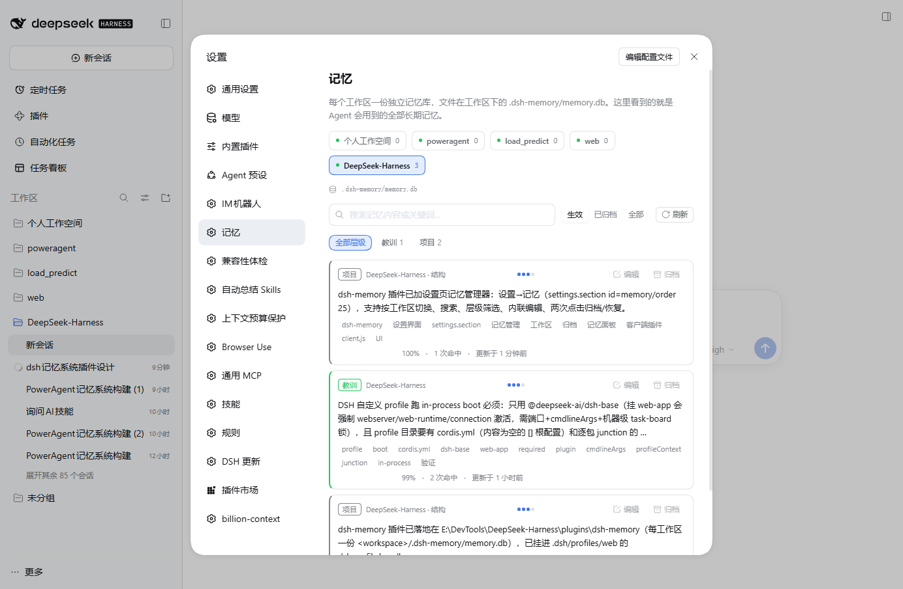
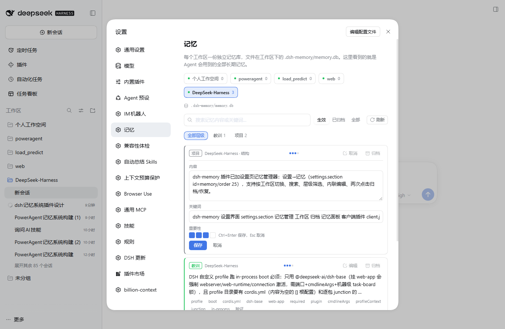
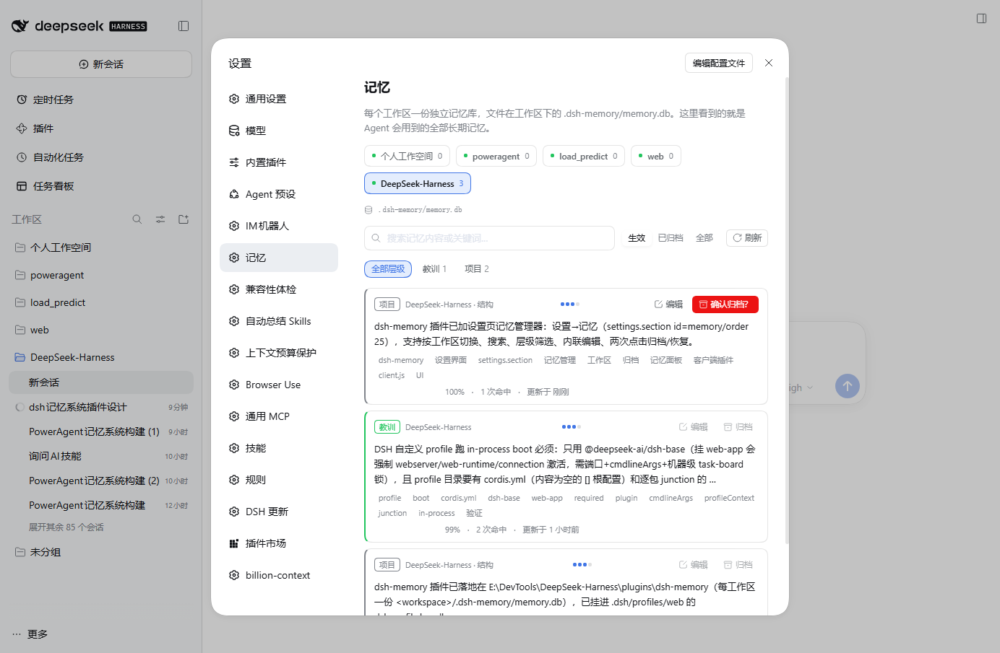
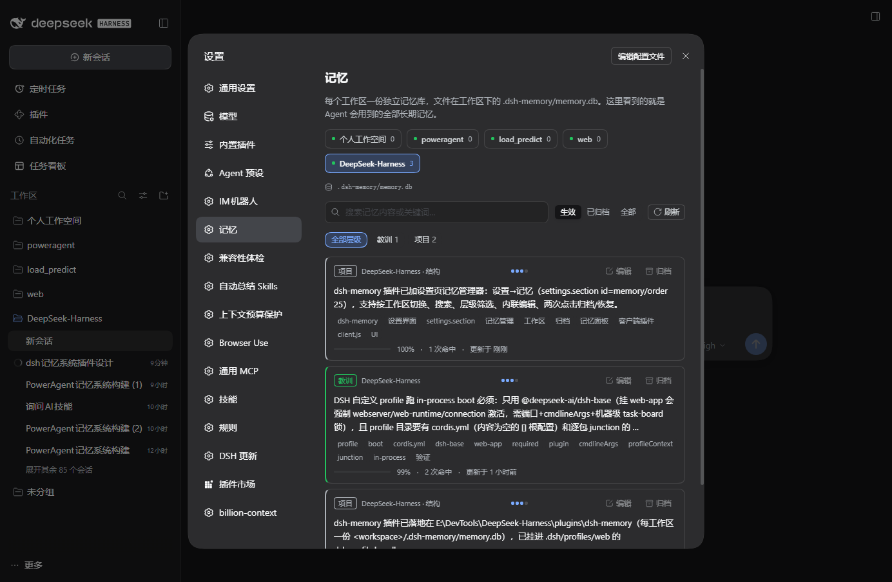

# dsh-memory

[](LICENSE)
[](https://nodejs.org)
[](test/)

**Per-workspace long-term memory for [DSH (DeepSeek Harness)](https://github.com/fryng).**
Each workspace gets its own SQLite database at `<workspace>/.dsh-memory/memory.db` — local, deletable, never shared between projects.

> 每个工作区一份独立的 SQLite 记忆库，本地、可删、互不串味。中文检索走 FTS5 `trigram`，注入不破坏 KV 缓存，写回由确定性闸门触发。

---

## English

### Why another memory plugin

Memory systems usually fail in one of two ways: **retrieval misses** (Chinese tokenization silently returns nothing) or **nothing is ever written** ("the agent should remember to call the tool" stays empty in practice). This plugin makes both deterministic:

- **Per-workspace isolation** — data lives inside the workspace. Delete the workspace, the memory goes with it.
- **Chinese actually matches** — FTS5 `trigram` + per-term phrase quoting + a `LIKE` fallback for 2-character queries (`unicode61` matches zero Chinese; `trigram` matches zero queries shorter than 3 characters — both gaps are covered).
- **Cache-safe injection** — the system prompt only carries a constant usage guide. Everything dynamic (first-turn snapshot, per-turn recall) travels in the message list, so the provider's KV prefix stays intact.
- **Deterministic writeback** — a trigger word (记住 / 以后 / 我喜欢 / remember / always …) or every N user turns fires one independent extraction call whose only evidence is that user message. Dedupe, merge, supersede and audit are part of the write path.
- **Archive, never delete** — `archive` flips `status`; rows and full text stay.

### Install

Requirements: a DSH installation with a profile (default `web`), and Node **>= 22.5** for the installer/tests (DSH ships its own runtime for the plugin itself).

`DSH_HOME` is the directory that contains `profiles/<name>/`. On the desktop build it is usually:

| OS | Default `DSH_HOME` |
| --- | --- |
| Windows | `%APPDATA%\dsh-desktop\dsh-home` |
| macOS | `~/Library/Application Support/dsh-desktop/dsh-home` |
| Linux | `${XDG_CONFIG_HOME:-~/.config}/dsh-desktop/dsh-home` |

The CLI also honours `$DSH_HOME` and `~/.dsh`, and `dsh-memory status` prints what it resolved.

#### A. From GitHub, no build (recommended)

```bash
# 1. put the package where DSH resolves profile bundles from
npm install --prefix "<DSH_HOME>/profiles/web" --no-save github:fryng/dsh-memory

# 2. register the bundle in that profile's package.json
node "<DSH_HOME>/profiles/web/node_modules/dsh-memory/scripts/cli.mjs" install \
  --profile web --dsh-home "<DSH_HOME>"
```

#### B. From a clone (developer loop)

```bash
git clone https://github.com/fryng/dsh-memory.git
cd dsh-memory
npm install          # esbuild only
npm run build        # src/ -> lib/index.js + lib/client.js
node scripts/cli.mjs install --profile web     # links this checkout into the profile
```

`install` creates a directory junction/symlink at `<profile>/node_modules/dsh-memory` and appends `dsh-memory` to `dsh.profile.bundles`. It is idempotent, never deletes, and never touches your own `cordis.patch.yml`; the profile's `package.json` is backed up before every edit. Rebuild (`npm run build`) and restart DSH to pick up source changes.

#### C. From the release tarball

```bash
npm pack            # or download dsh-memory-<version>.tgz from Releases
tar -xzf dsh-memory-0.1.0.tgz
node package/scripts/cli.mjs install --copy --profile web --dsh-home "<DSH_HOME>"
```

### Verify

```bash
node scripts/cli.mjs status     # links, bundles, build artifacts
node scripts/cli.mjs doctor      # every precondition, one line each
```

Then restart DSH. You should see `dsh-memory 已挂载` in the plugin log and a **设置 → 记忆** (Settings → Memory) section. First write creates `.dsh-memory/memory.db` in the workspace being used.

### Tools

| Tool | Purpose |
| --- | --- |
| `memory_remember` | explicit write (content + level; optional keywords / importance / project / subcategory / goal) |
| `memory_search` | search (query required; optional level / status / k / project) |
| `memory_read` | read one entry by id |
| `memory_update` | edit one entry; `status: 'archived'` archives it |
| `memory_status` | database overview + recent audit rows |

`/mem` prints the same overview. `toolPrefix` (e.g. `memory_`) namespaces tools and the command — needed only when something else already registered the same names.

### Configuration

Plugin defaults live in [`cordis.patch.yml`](cordis.patch.yml); override any key in your profile's `cordis.patch.yml` (the user layer deep-merges on top):

```yaml
- id: dsh-memory
  config:
    writeback:
      everyNUserTurns: 2   # more eager than the default 4
```

| Key | Default | Notes |
| --- | --- | --- |
| `enabled` | `true` | `false` registers nothing |
| `dataDir` | `.dsh-memory` | workspace-relative; absolute paths and `..` are rejected |
| `promptLang` | `zh` | `zh` / `en` |
| `systemGuide` | `true` | inject the constant system-prompt guide |
| `toolPrefix` | `''` | tool/command namespace, shaped like `memory_` |
| `hitTopK` | `3` | recall entries per turn |
| `recallMinRelevance` | `0.15` | recall floor relative to the best hit |
| `snapshotBudgetChars` | `2400` | first-turn snapshot budget |
| `recallBudgetChars` | `900` | per-turn recall budget |
| `writeback.mode` | `trigger` | `off` / `trigger` / `always` |
| `writeback.everyNUserTurns` | `4` | interval fallback (the main channel in real sessions) |
| `writeback.model` | `''` | empty = inherit the live agent's model |
| `writeback.minChars` | `8` | length floor for the **interval** path only — trigger words bypass it |
| `writeback.maxPerTurn` | `3` | max entries written per turn |
| `writeback.cooldownSeconds` | `30` | minimum gap between extractions |

An invalid config refuses to mount and logs one error — a half-loaded plugin is worse than a disabled one.

### Privacy

Everything is local. The client talks to three same-origin JSON routes (`/api/dsh-memory/...`) gated by `connection.requestRejection` plus same-origin and loopback checks. No network calls, no telemetry, no cloud.

### Development

```bash
npm install
npm run build
npm test                          # 48 cases: host 31 + client 9 + routes 8
node scripts/demo.mjs .demo-memory-workspace   # seven-step end-to-end run
```

See the Chinese section below for the architecture, ranking formula, writeback debt model and the settings panel.

---

## 中文

DSH 的**按工作区隔离**的长期记忆插件。每个工作区一份独立的 SQLite 库（`<workspace>/.dsh-memory/memory.db`），本地、可删、互不串味。

它解决的问题是：记忆系统常见两种失败——**检索不到**（中文分词失效、召回是摆设）和**根本没写进去**（"让 agent 自己记得调工具"在实践中一直是空的）。这个插件两条都按确定性方式解决。

## 它做什么

1. **每工作区独立**——数据落在工作区内的 `.dsh-memory/`。删掉工作区，记忆随之消失；两个项目永远不共享记忆池。
2. **中文真的能搜到**——FTS5 `trigram` 索引 + 每词双引号 phrase 化 + 两字/短词用 `LIKE` 兜底（`unicode61` 对中文零命中，`trigram` 对 <3 字零命中，两条都得补）。
3. **注入不破坏缓存**——system prompt 里只有一段**恒定文本**的使用说明（不含任何当前记忆内容）；真正会变的东西（首轮快照、每轮召回）走消息列表。
4. **写入是确定性的**——命中"记住 / 以后 / 我喜欢 / remember / always …"这类触发词（或每 N 个用户轮次），就发起**一次独立的抽取调用**，证据**只有那条用户消息**；抽完做去重合并、冲突超替，每一步都写审计。
5. **只归档不删除**——`archive` 只是把 `status` 改成 `archived`，行和全文都留着。

## 记忆分六层

| level | 存什么 |
| --- | --- |
| `fact` | 客观事实（路径、版本、环境、外部约束、命令） |
| `preference` | 用户偏好（语言、风格、工具、回复习惯） |
| `rule` | 必须遵守的准则与红线（含被明确纠正过的做法） |
| `decision` | 选型与取舍，含"为什么选 X 不选 Y" |
| `lesson` | 踩过的坑（这次错在哪、下次怎么避免） |
| `project` | 项目自身的结构与进展（架构、入口、待办），可带 `subcategory` |

`project` 字段是**工作区/项目名**，`全局` 是特殊值，任何项目下都能被检索到（`global` / `__global__` / `*` 都归一成它）。

## 注入的三条通道

| 通道 | 位置 | 预算 | 时机 |
| --- | --- | --- | --- |
| 使用说明 | system prompt 段 `dsh-memory-guide` | — | 恒定，一次注册 |
| 首轮快照 | 消息列表（`<!--dsh-memory:snapshot-->`） | 2400 字符 | 会话首条人类消息前，一次 |
| 定向召回 | 消息列表（`<!--dsh-memory:recall-->`） | 900 字符 | 每轮，`relevance ≥ 0.15`，按 seen 去重 |

压缩（`compaction/*`）之后会**重新注入**快照——否则被压缩掉的记忆就再也回不来了。子代理会话（`origin === 'subagent'`）不注入。

## 工具

| 工具 | 用途 |
| --- | --- |
| `memory_remember` | 显式写入（内容 + 层；可选 keywords / importance / project / subcategory / goal） |
| `memory_search` | 检索（query 必填；可选 level / status / k / project） |
| `memory_read` | 按 id 读一条 |
| `memory_update` | 改一条；`status: 'archived'` 走归档 |
| `memory_status` | 库概况 + 最近审计 |

`/mem` 命令打印同样的概况。配置 `toolPrefix`（如 `memory_`）可给全部工具与命令加命名空间——**只有当别处已经注册了同名工具时**才需要，DSH 遇到重名工具会拒绝加载整棵插件树。

## 打分

`rankEntries` 是纯函数（`src/ranking.js`），输入查询与候选条目：

```
score = bm25(query) × 遗忘衰减 × 重要性权重 + 使用强化
```

- 遗忘衰减 `exp(-Δt/S)`，`S = 半衰期(4 天) × (1 + 0.5 × (importance - 1))`；
- 重要性权重 `0.5 → 1.0`（importance 1 → 4）；
- 使用强化 `min(0.1, use_count × 0.01)`——被反复召回的记忆排得更高；
- 查询为空时退化为"重要性 × 新鲜度"，用于首轮快照。

分词是自实现的：拉丁词取 ≥2 字符，中文**去停用字后取 bigram**；兜底用的 `LIKE` 词表则**不做停用字过滤**（否则「中文」这种词会被过滤成空）。

## 埋点：为什么它不会"看起来在跑"

写回通道每次执行都留一行审计：`writeback`（写了几条）、`writeback-empty`（模型说没东西可记）、`writeback-error`（调用失败，附原因）。**"没有审计行"本身就是一个明确的失败信号**——对比之下，靠水位线推进来代表"反思跑过了"的设计，会在什么都没写的情况下照样盖章。

`memory_status` 与 `/mem` 都能看到最近的审计流水。

### 间隔回退为什么是「欠账式」而不是「第 N 轮」

最初用的是 `turnIndex % N === 0`。在真实会话上量出来两个缺陷，都已修：

- **短句会白白吃掉名额**。「好的改后测试」（6 字）刚好落在第 4 轮，被长度门槛跳过，而名额已经用掉——下一次要等到第 8 轮。改成**欠账**：每轮 +1，命中触发词或满 N 轮才清零，短句跳过但欠账保留。
- **`minChars` 不该管触发词**。原判定先查长度再查触发词，于是「记住」（2 字）这种最短、最明确的指令反而被丢掉。现在是触发词优先，长度门槛只约束间隔回退。
- 计数按**消息 id 去重**：`agent/pre-step` 每个 step 都会跑，一次带工具调用的轮次会以同一条消息多次到达。

按实测的这轮真实对话（7 条消息）重放：第 4 轮命中 `interval:4`，之后第 6、7 轮因为过短被跳过——不会再有「一整个会话一条都没抽」的情况。

## 设置界面

设置 → **记忆**（section id `memory`，order 25，排在通用/模型/插件/预设/账号之后）。



一屏里能做的事：

- **按工作区切换**——顶部是工作区胶囊，带条数的那个就是当前库；每个工作区一份库，互不影响。
- **看**——列表按更新时间倒序，每条左侧 2px 竖直色条按层级变色（准则红 / 偏好蓝 / 取舍橙 / 教训绿 / 事实灰 / 项目紫）；右侧四个小方块是重要性，下面那条进度是**记忆强度**（复刻 host 侧的遗忘曲线 + 使用强化，所以"很久没被召回的老事实"会明显变淡）。
- **搜**——中文两字及以上都走 FTS；输入停 220ms 才发请求（中文输入法上屏不会每键一跳）。
- **筛**——状态三档（生效 / 已归档 / 全部）+ 层级胶囊（带各层条数）。
- **改**——"编辑"展开内联编辑器：正文、关键词、重要性（可点）、所属项目；`Ctrl+Enter` 保存，`Esc` 取消。只有真改动过的字段才会提交。

  

- **删**——"归档"是**两次点击**：第一下变红底"确认归档？"，4 秒内不点第二下自动撤销。归档后条目仍在（可在"已归档"里翻回来"恢复"），符合 archive-never-delete。

  

- 长正文默认 3 行截断，点一下展开；底部一行是库文件路径，方便直接去磁盘上找。

深色主题走 `body[data-ds-dark-theme]`，面板里没有任何硬编码颜色，全部吃 `--dsw-alias-*` 令牌：



客户端数据走 host 注册的三条同源 JSON 路由（`/api/dsh-memory/workspaces|items|mutate`），鉴权用 `connection.requestRejection(req)`，并额外要求同源 + loopback——**不联网、不出本机**。

## 安装（中文）

三条路，任选其一：

```bash
# A. 从 GitHub 装，不构建
npm install --prefix "<DSH_HOME>/profiles/web" --no-save github:fryng/dsh-memory
node "<DSH_HOME>/profiles/web/node_modules/dsh-memory/scripts/cli.mjs" install --profile web

# B. 克隆后构建（改源码用这条）
git clone https://github.com/fryng/dsh-memory.git && cd dsh-memory
npm install && npm run build
node scripts/cli.mjs install --profile web

# C. Release 压缩包
npm pack        # 或从 Releases 下载 dsh-memory-<version>.tgz
tar -xzf dsh-memory-0.1.0.tgz
node package/scripts/cli.mjs install --copy --profile web
```

`cli.mjs install` 是幂等的、只增不删：建 `<profile>/node_modules/dsh-memory` 目录联接（`--copy` 则实体复制），并把 `dsh-memory` 追加到 `<profile>/package.json` 的 `dsh.profile.bundles`（改前备份 `package.json.bak-dsh-memory-<时间戳>`）。它**不动**你自己的 `cordis.patch.yml`。

`DSH_HOME` 自动探测顺序：`--dsh-home` → `$DSH_HOME` → 桌面端默认位置（Windows `%APPDATA%\dsh-desktop\dsh-home`，macOS `~/Library/Application Support/dsh-desktop/dsh-home`，Linux `${XDG_CONFIG_HOME:-~/.config}/dsh-desktop/dsh-home`）→ `~/.dsh` → 当前目录的 `.dsh`。探测不到就报错并列出所有候选，用 `--dsh-home` 指定即可。

```bash
node scripts/cli.mjs status    # 看挂载状态
node scripts/cli.mjs doctor    # 逐项自检
node scripts/cli.mjs uninstall # 摘除（profile package.json 先备份）
```

想覆盖默认值，就在 profile 的 `cordis.patch.yml` 里写同名条目（用户层会深合并到插件默认层之上）：

```yaml
- id: dsh-memory
  config:
    writeback:
      everyNUserTurns: 2   # 更积极一点（默认 4）
```

## 配置

| 键 | 默认 | 说明 |
| --- | --- | --- |
| `enabled` | `true` | `false` 时什么都不注册 |
| `dataDir` | `.dsh-memory` | 工作区内的相对目录，拒绝绝对路径与 `..` |
| `promptLang` | `zh` | `zh` / `en` |
| `systemGuide` | `true` | 是否注入 system prompt 使用说明 |
| `toolPrefix` | `''` | 工具/命令命名空间，需形如 `memory_` |
| `hitTopK` | `3` | 每轮召回条数 |
| `recallMinRelevance` | `0.15` | 召回下限（相对最相关那条） |
| `snapshotBudgetChars` | `2400` | 首轮快照硬预算 |
| `recallBudgetChars` | `900` | 每轮召回硬预算 |
| `writeback.mode` | `trigger` | `off` / `trigger` / `always` |
| `writeback.everyNUserTurns` | `4` | 间隔回退：距上次写回满 N 轮就抽一次（实测触发词在真实对话里几乎不命中，这是主力通道） |
| `writeback.model` | `''` | 空 = 继承当前 agent 的模型 |
| `writeback.minChars` | `8` | 只对**间隔回退**生效的长度门槛；命中触发词的消息不受此限（「记住」两个字也要能触发） |
| `writeback.maxPerTurn` | `3` | 单轮最多入库条数 |
| `writeback.cooldownSeconds` | `30` | 两次抽取的最小间隔 |

配置非法时**拒绝挂载**并打一条 error 日志（`resolveConfig` 是唯一校验点；cordis 层的 schema 故意不校验，那里抛错会让整个 web 起不来）。未知键只告警。

## 验证

```bash
node --test test/*.test.mjs                         # 48 个用例（host 31 + 客户端 9 + 路由 8）
node scripts/demo.mjs .demo-memory-workspace        # 真实 boot 的七步端到端演示
node scripts/verify-web-profile.mjs                 # 在真实 web profile 里核验挂载
```

> `node --test test/`（裸目录）在本机报 `Cannot find module`，必须用 glob。

`demo.mjs` 会自己确保一个叫 `mem-verify` 的一次性 profile 存在（只挂 `@deepseek-ai/dsh-base` + 本插件，**故意不挂 web-app**，因为 web bundle 会强制 `webserver` / `web-runtime` / `connection` 激活，需要端口和机器级独占的 task-board 账本），然后 boot 它，并**直接调用插件注册的 `agent/pre-step` 监听器**（synthetic agent），跑：挂载 → 每工作区隔离 → 写入 → 首轮快照 → 定向召回 → 写回闸门（含一次真实模型抽取）→ 读回与审计。

`verify-web-profile.mjs` 走 `runProfile`（真实 web 启动器，因为 web bundle 强制要求 `cmdlineArgs` / `profileContext` / `PluginPackages`，这些只有真启动器会 provide），断言 5 个工具、guide 段与命令都在真实 web profile 里。这两个脚本要在**本仓库自己的 `.dsh`** 里跑（或用 `DSH_HOME` 指定），它们不是给最终用户用的。

> `link-profile-deps.mjs` 是给一次性 profile 补依赖解析的：pnpm 把 bundle 的依赖**嵌套**装在各 bundle 自己的 `node_modules` 下，而 Node 的解析器只会向上找祖先目录，所以这些包对 profile 不可见，必须逐个 junction 到 `<profile>/node_modules/@deepseek-ai`。

## 目录

```
dsh-memory/
├── cordis.patch.yml    插件默认配置层
├── build.mjs           esbuild：src/ → lib/index.js + lib/client.js
├── scripts/cli.mjs     install / status / uninstall / doctor / prune
├── src/
│   ├── index.js        入口：apply、pre-step 注入、压缩重注入、写回调、/api 路由
│   ├── config.js       默认值 + 合并 + 校验（唯一校验点）
│   ├── prompts.js      system guide（中英）与抽取提示词
│   ├── ranking.js      BM25 × 遗忘曲线 × 重要性 + 使用强化（纯函数）
│   ├── fts.js          MATCH 表达式构造、trigram 词项、LIKE 兜底词表
│   ├── writeback.js    触发闸门、JSON 恢复、fact 校验、独立抽取调用
│   ├── llm.js          独立模型调用通道（不进用户会话）
│   ├── tools.js        5 个记忆工具
│   ├── commands.js     /mem
│   ├── host-routes.js  /api/dsh-memory 三条同源 JSON 路由
│   ├── store/db.js     node:sqlite 单文件库（memories + FTS5 + 触发器 + 审计）
│   ├── store/memory-repo.js  仓储：去重合并、冲突超替、归档、召回
│   ├── inject/         消息构造、system 段、快照与召回装配
│   └── client/         浏览器半边：locale、api、store、css、section.jsx、挂载
├── scripts/            cli / mount / demo / verify-web-profile / link-profile-deps / prune-empty
└── test/               48 个用例
```

## 清理空库

库文件是在**第一次写入**时创建的。一个空库（没有记忆、没有审计）没有任何用处，只会让工作区看起来"有记忆"。浏览设置页**不会**创建库——读路径只回答"这个工作区还没有记忆文件"，不落地文件。

如果历史遗留了空库（旧版本的读路径会创建），用：

```bash
node scripts/cli.mjs prune --root E:/DevTools --dry-run   # 先看会删什么
node scripts/cli.mjs prune --root E:/DevTools             # 真删
```

它只删「memories 与 audit_log 都为 0 行」的 `.dsh-memory` 目录，有内容的库一律不动；被运行中的 dsh 占用的文件会报 `locked` 并跳过——关掉 dsh 再跑一次即可。

## 不变量

- **archive never delete**：归档只改状态，SQL 里没有 `DELETE`。
- **每次变更写审计**：写入 / 合并 / 超替 / 归档 / 更新 / 写回结果全部留痕。
- **配置非法就不挂载**：宁可插件不生效，也不带病半装载。
- **system prompt 段恒定**：动态内容一律走消息列表，保住 provider 的 KV 缓存前缀。

## License

[MIT](LICENSE) © 2026 fryng
